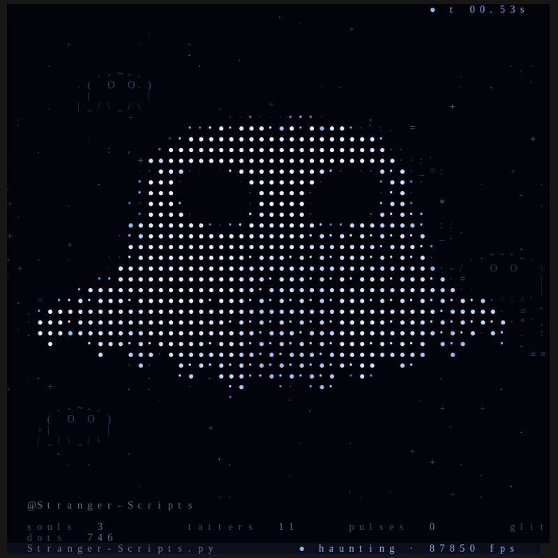

# ascii-creations-hub

A growing collection of animated ASCII / ANSI art for the terminal.
Each creation is a single, self-contained Python script that uses only the standard library.



<sub>`specter.py --seed 7`, recorded with [VHS](https://github.com/charmbracelet/vhs) from [`animation.tape`](animation.tape).</sub>

<details>
<summary>Plain-text frame</summary>

```
                .               '  .
       .  .-~-. .    .    x00:specter:   .
     .   ( O O )     . ●●●●●●●●●●●●●•●●• =.          .     + '.
        .|     |.     •●●●●●●●●●●●●●●●●●●·           .   .    .
     .  .|_/\_/\     ·●●●●●●●●●●●●●●●●●●•●           +
 '            +     ·•●●·   ●●●●●●●•    ●●●·  .               .
   *     .     .    •●●•     ●●●●●·     ·●•·=
               +    ●●●•     ·●●●●·     ●●●· -   +         .
'          .        •●●●·    ●•●●●•    ●●●●●,-          .    ..
+.     .            ●●●●●●●●●●●●●●●●●●●●●●●● . .   *           .
                .  •●●●●●●●●●●•●•●●●•●●●•●●•·
 .  .  .*         ·●●●●●●●●●●●●●●●●●●●●●●●●●• :=      .-"""-.
.+      .   .     •●●●●●●●•●●●•●●●•●●●●●●●•●· =:     /  O O  \
              ·  ·●●●●●●●●●●●●●●●●●●●●●●●●●●●•+      |       | +
 . .           ••●●●•●●●•●•●•●•●•●●●•●●●•●•●•●··      |     . |
  '.   +      ●●●●●●●●●●●●●●●●●●●●●●●●●●●●●●●•●●●    '^-^-^-^'
            •●●●●●●●●●●●●●•●•●•●●●●●●●●●•●•●•●•●•• :        .
  . .     . ●●●●●●●●●●●●●●●●●•●●●●●●●●●●●•●•●•●·●● .
.    +.-~'.  ● +•● ●•●●●•●•●•●•●•●●●•●●●•●•●••• .         .
     ( O O )  • ●. •●●●●●●●●●●●•●●●●●●●●●•●•· ·    +    +
    .|     |   ·    •  ••• ●•·•●•·•●•●•• ·          .        .
     |_/\_/\  .           .·   •  ●•     .     +  +  .
```
<sub>`specter.py --snapshot 6 --no-color --seed 7`</sub>

</details>

## Creations

| Creation | Script | Description |
|----------|--------|-------------|
| **Specter** | [`src/specter.py`](src/specter.py) | Animated ghost in two forms (halftone sheet ghost or hooded wraith), with a twinkling starfield, drifting mini-ghosts, trailing wisps, glitch bursts and a status HUD. |

More to come.

## Requirements

- Python 3.8 or newer
- No third-party packages
- A terminal with ANSI support. Truecolor is recommended (Windows Terminal, kitty, WezTerm, Alacritty, GNOME Terminal, iTerm2, …)
- UTF-8 output for the Unicode glyph sets. If stdout isn't UTF-8, Specter falls back to plain ASCII automatically.

## Quick start

```bash
git clone https://github.com/Stranger-Scripts/ascii-creations-hub.git
cd ascii-creations-hub
python3 src/specter.py
```

Press `Ctrl+C` to quit.

---

## Specter

An animated ghost that haunts your terminal. It draws in the alternate screen buffer, hides the cursor while it runs, and restores both when you quit. It adapts to the terminal size on every frame, so you can resize the window while it's running.

### Forms

| Form | Default palette | Description |
|------|-----------------|-------------|
| `sheet` (default) | `halftone` | A classic sheet ghost rendered as a halftone with tattered hem. |
| `wraith` | `spectral` | A hooded wraith with claws, its body woven from letters. |

### Usage

```bash
python3 src/specter.py                          # halftone sheet ghost
python3 src/specter.py --glyphs blocks          # chunkier pixel look
python3 src/specter.py --glyphs ascii           # no Unicode needed
python3 src/specter.py --form wraith            # the hooded wraith with claws
python3 src/specter.py --palette void --name nullcaller --no-glitch
python3 src/specter.py --list-palettes
python3 src/specter.py --snapshot 5 > frame.txt # render a single frame and exit
python3 src/specter.py --help                   # full list of options
```

### Options

| Option | Default | Description |
|--------|---------|-------------|
| `-f`, `--form {sheet,wraith}` | `sheet` | Which ghost to draw. |
| `-p`, `--palette NAME` | `halftone` for sheet, `spectral` for wraith | Colour scheme (see below). |
| `-g`, `--glyphs {dots,blocks,ascii}` | `dots` | Character set for the sheet's halftone. `dots` and `blocks` need UTF-8. |
| `-n`, `--name NAME` | `specter` | Handle shown in the HUD and woven into the body. |
| `--fps N` | `30` | Target frame rate. |
| `--tendrils N` | `11` sheet, `7` wraith | Number of tatters in the hem (minimum 3). |
| `--strands N` | `8` | Number of trailing wisps below the body (minimum 2). |
| `--seed N` | random | Seed for a reproducible layout. |
| `--no-glitch` | off | Disable the periodic glitch bursts. |
| `--no-color` | off | Monochrome output. The `NO_COLOR` environment variable is also respected. |
| `--transparent` | off | Keep the terminal's own background instead of painting the palette's. |
| `--list-palettes` | | Print the available palette names and exit. |
| `--snapshot T` | | Print a single frame at time `T` (seconds) and exit. Combine with `--no-color` for plain text. |

### Palettes

| Palette | Look |
|---------|------|
| `halftone` | White halftone sheet on midnight navy, red eyes |
| `spectral` | Cold pale blue, burning red eyes |
| `void` | Violet void, white-hot eyes |
| `ecto` | Sickly ectoplasm green, sulphur-yellow eyes |
| `bone` | Bone white, blood-red eyes |

---

## Repository layout

```
ascii-creations-hub/
├── assets/
│   └── specter.gif     # README preview, generated from animation.tape
├── src/
│   └── specter.py      # Specter (sheet + wraith)
├── animation.tape      # VHS script that records the preview GIF
├── requirements.txt
└── README.md
```

## Recording the previews

The GIFs in this README are recorded with [VHS](https://github.com/charmbracelet/vhs), so they can be regenerated with one command instead of screen-capturing by hand. VHS needs `ttyd` and `ffmpeg` on your `PATH`.

```bash
mkdir -p assets
vhs animation.tape      # writes assets/specter.gif
```

The tape fixes the seed, frame rate and terminal size, so re-recording gives the same layout.

## Adding a new creation

New creations follow the same pattern as Specter:

1. Put it in a single script under `src/`, using only the standard library.
2. Give it an `argparse` CLI so `--help` documents every option.
3. Clean up the terminal on exit (reset colours, show the cursor, leave the alternate screen).
4. Add a row to the [Creations](#creations) table and a section of its own below it, with a preview, usage examples and an options table.
5. Record the preview with a VHS tape (copy `animation.tape` and change the command and `Output`) and save the GIF under `assets/`.
